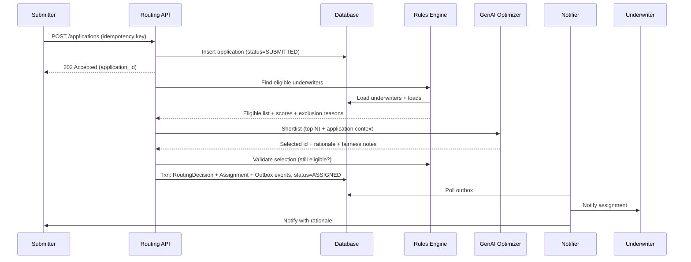

# Spec: GenAI-Powered Loan Application Underwriter Assignment

**Status:** Draft v0.1
**Last updated:** 2026-11-06

---

## 1. Problem & Goal

Loan applications must be routed to the right underwriter quickly, fairly, and in a way that can be explained and audited later. Manual or round-robin assignment ignores expertise, workload, and SLA risk; a pure-AI approach is non-deterministic and hard to audit.

**Goal:** Build a routing service where a **deterministic rules engine** produces a ranked, eligible shortlist and a **GenAI layer** picks the best candidate *from that shortlist* and explains why. Every decision is recorded, explainable, overridable, and fed back to improve future routing.

### Design principle: "Rules decide what's allowed, AI decides what's best"

| Concern | Owned by |
|---|---|
| Eligibility (licence, authority limit, conflict of interest, availability) | Rules engine (hard constraints) |
| Base ranking (workload, skill match, SLA headroom) | Rules engine (weighted score) |
| Final pick + rationale (contextual fit, fairness, SLA risk trade-off) | GenAI, constrained to the shortlist |
| Validation of the final pick | Rules engine (re-check) |
| Fallback when GenAI fails | Rules engine top-ranked candidate |

The LLM can **never** assign someone the rules engine did not approve.

---

## 2. Actors

| Actor | Description |
|---|---|
| **Submitter** | Loan officer / broker who logs an application and can query why it was routed |
| **Underwriter** | Receives assigned applications; has skills, authority limits, capacity |
| **Supervisor** | Can override assignments (with a reason) and view fairness dashboards |
| **System** | Routing service, rules engine, GenAI optimizer, notifier, feedback loop |

---

## 3. Domain Model

### 3.1 LoanApplication
| Field | Type | Notes |
|---|---|---|
| `id` | UUID | |
| `idempotency_key` | string | Unique; supplied by submitter client |
| `submitter_id` | UUID | |
| `loan_type` | enum | `HOME`, `AUTO`, `PERSONAL`, `BUSINESS`, `LAP` |
| `amount` | decimal | |
| `currency` | string | |
| `region` | string | Jurisdiction / state |
| `priority` | enum | `NORMAL`, `HIGH`, `URGENT` |
| `risk_band` | enum | `LOW`, `MEDIUM`, `HIGH` (from pre-screen / credit score band) |
| `complexity_flags` | string[] | e.g. `SELF_EMPLOYED`, `MULTI_PROPERTY`, `FOREIGN_INCOME` |
| `sla_due_at` | timestamp | Derived from priority + loan type |
| `status` | enum | See state machine §5 |
| `version` | int | Optimistic locking |
| `created_at` | timestamp | |

> **Fair-lending guardrail:** protected attributes (race, gender, religion, age, marital status, nationality, etc.) are **not stored in the routing context** and are **never sent to the LLM**. Only the routing-relevant fields above are used.

### 3.2 Underwriter
| Field | Type | Notes |
|---|---|---|
| `id` | UUID | |
| `name` | string | |
| `skills` | string[] | Loan types + complexity flags they handle |
| `licensed_regions` | string[] | |
| `authority_limit` | decimal | Max loan amount they can approve |
| `max_active_cases` | int | Capacity |
| `active_cases` | int | Current load (derived or maintained) |
| `status` | enum | `AVAILABLE`, `ON_LEAVE`, `OFFLINE` |
| `performance` | object | Rolling metrics: avg turnaround, SLA hit rate, rework rate (see §8) |

### 3.3 RoutingDecision (the audit record — immutable)
| Field | Type | Notes |
|---|---|---|
| `id` | UUID | |
| `application_id` | UUID | |
| `attempt` | int | 1 for first routing, increments on re-route |
| `input_snapshot` | JSON | Application + candidate states exactly as seen at decision time |
| `rules_version` | string | |
| `weights_version` | string | Version of adaptive weights used |
| `eligible_candidates` | JSON | List with per-candidate scores and filter reasons for excluded ones |
| `shortlist` | JSON | Top-N passed to GenAI |
| `llm_model` | string | Model id |
| `llm_prompt_version` | string | |
| `llm_request` / `llm_response` | JSON | Raw, for audit |
| `selected_underwriter_id` | UUID | |
| `decision_source` | enum | `GENAI`, `RULES_FALLBACK`, `MANUAL_OVERRIDE` |
| `rationale` | text | Human-readable explanation |
| `fairness_signals` | JSON | See §7 |
| `latency_ms` | int | |
| `created_at` | timestamp | |

### 3.4 Assignment
| Field | Type | Notes |
|---|---|---|
| `application_id` | UUID | **Unique where `active = true`** → prevents duplicate routing |
| `underwriter_id` | UUID | |
| `routing_decision_id` | UUID | |
| `active` | bool | |
| `assigned_at` | timestamp | |

### 3.5 Override
| Field | Type | Notes |
|---|---|---|
| `id` | UUID | |
| `application_id` | UUID | |
| `from_underwriter_id` / `to_underwriter_id` | UUID | |
| `actor_id` | UUID | Supervisor |
| `reason_code` | enum | `EXPERTISE`, `WORKLOAD`, `CONFLICT_OF_INTEREST`, `CUSTOMER_REQUEST`, `OTHER` |
| `reason_text` | text | Mandatory |
| `created_at` | timestamp | |

### 3.6 Outcome (feedback)
| Field | Type | Notes |
|---|---|---|
| `application_id` | UUID | |
| `underwriter_id` | UUID | |
| `completed_at` | timestamp | |
| `turnaround_hours` | number | |
| `sla_met` | bool | |
| `reworked` | bool | Sent back / escalated |
| `overridden` | bool | |

### 3.7 OutboxEvent
For reliable notifications (see §9.1): `id`, `event_type`, `payload`, `status`, `attempts`, `created_at`.

---

## 4. End-to-End Flow



### Step 1 — Submitter logs a loan application
- `POST /applications` with required fields (§3.1) and an `Idempotency-Key` header.
- Validate schema and business rules (amount > 0, known loan type/region, etc.).
- If the idempotency key already exists → return the **existing** application (no new record).
- Persist with `status = SUBMITTED`; compute `sla_due_at`.
- Return `202 Accepted` with `application_id`. Routing proceeds asynchronously (or synchronously within a latency budget — see §9.4).

### Step 2 — System identifies eligible underwriters (hard filters)
Load all underwriters and apply **hard constraints**. Each exclusion is recorded with a reason.

| Filter | Rule |
|---|---|
| Availability | `status == AVAILABLE` |
| Capacity | `active_cases < max_active_cases` |
| Authority | `authority_limit >= amount` |
| Licence | `region ∈ licensed_regions` |
| Skill | `loan_type ∈ skills` and all `complexity_flags ⊆ skills` (configurable: strict vs. partial) |
| Conflict of interest | Underwriter not linked to submitter/applicant (configurable list) |

**If no one is eligible:** status → `UNROUTABLE`, alert supervisor queue, record decision with all exclusion reasons. Never silently drop.

### Step 3 — Rules engine filters and ranks candidates (soft scoring)
For each eligible underwriter compute a deterministic score in `[0, 1]`:

```
score = w_skill    * skill_match
      + w_load     * (1 - active_cases / max_active_cases)
      + w_sla      * sla_hit_rate
      + w_speed    * normalized_turnaround_speed
      + w_fair     * (1 - recent_assignment_share_normalized)
```

- Weights come from a versioned config (`weights_version`), initially hand-set, later tuned by the feedback loop (§8).
- Ties broken deterministically (e.g. lowest `active_cases`, then underwriter `id`).
- Output: full ranked list; **top N (default 5)** forms the shortlist.
- If shortlist size is 1 → skip GenAI, assign directly (`decision_source = RULES_FALLBACK`, rationale generated from template).

### Step 4 — GenAI optimizes for fairness, SLA risk, and contextual fit
**Input to LLM** (structured JSON, no PII, no protected attributes):
- Application: loan type, amount band, region, priority, risk band, complexity flags, time to SLA.
- Shortlist: per candidate — rules score and its components, current load, SLA hit rate, relevant skills, recent assignment count.
- Fairness context: team load distribution summary.

**Instructions to LLM:**
- Choose exactly one candidate **from the shortlist**.
- Balance: contextual fit (complexity ↔ expertise), SLA risk (time remaining vs. candidate's speed/load), fairness (avoid over-loading top performers).
- Return strict JSON:

```json
{
  "selected_underwriter_id": "uuid",
  "confidence": 0.0,
  "rationale": "2-4 sentences, plain English, for the submitter",
  "factors": [{"factor": "complexity_fit", "impact": "positive", "detail": "..."}],
  "alternatives_considered": [{"underwriter_id": "uuid", "why_not": "..."}]
}
```

**Determinism controls:**
- Temperature 0, fixed prompt version, fixed model id, structured output / JSON schema validation.
- Full request/response stored in `RoutingDecision`.
- Explaining or replaying a past decision **reads the stored record**; it never re-calls the LLM to "re-decide".

**Guardrails / fallback** (→ `decision_source = RULES_FALLBACK`, rules top-1 is assigned):
- LLM timeout (default 3 s) or error.
- Response fails JSON schema validation.
- Selected id not in shortlist.
- Confidence below threshold (configurable).

### Step 5 — Underwriter assigned & notified; submitter receives rationale
1. **Re-validate** the selected underwriter against hard filters (state may have changed during the LLM call).
   If invalid → try next candidate in order; if none → `UNROUTABLE`.
2. In **one DB transaction**:
   - Insert `RoutingDecision`.
   - Insert `Assignment` (unique active constraint guards against duplicates).
   - Increment underwriter `active_cases` (with optimistic lock / row lock).
   - Update application `status = ASSIGNED` (version check).
   - Insert `OutboxEvent`s: `UNDERWRITER_ASSIGNED`, `SUBMITTER_NOTIFIED`.
3. Notifier worker delivers outbox events (email / in-app / webhook), with retries.
4. Submitter can view the rationale via `GET /applications/{id}/routing`.

---

## 5. Application State Machine

```
SUBMITTED ──> ROUTING ──> ASSIGNED ──> IN_REVIEW ──> COMPLETED
                │             │
                │             └──(override)──> ASSIGNED (new assignment, old one deactivated)
                └──> UNROUTABLE ──(manual assign / capacity freed)──> ROUTING
```

- Transitions are guarded by `version` (optimistic locking). Illegal transitions are rejected.
- `ROUTING` has a lease timeout (e.g. 30 s). A **sweeper job** re-queues applications stuck in `SUBMITTED`/`ROUTING` beyond the lease → no missed routings.

---

## 6. Key GenAI Differentiators

### 6.1 Explainable decisions
Every `RoutingDecision` contains:
- **Rationale** — plain English for the submitter.
- **Factors** — structured list of what drove the choice.
- **Alternatives considered** — why other shortlisted candidates were not chosen.
- **Exclusions** — why non-eligible underwriters were filtered out (from rules engine, deterministic).

For `RULES_FALLBACK` decisions, a templated rationale is generated from score components (no LLM needed).

### 6.2 Adaptive optimization
See §8. The system learns from outcomes by **tuning rules-engine weights and underwriter performance metrics**, not by retraining the LLM. This keeps learning transparent and versioned.

### 6.3 Natural-language queries
`POST /applications/{id}/ask` — submitter asks e.g.:
- "Why was my application given to Priya and not Arjun?"
- "When will it likely be reviewed?"
- "Was workload considered?"

**How it works:**
- Retrieve **only** the stored `RoutingDecision`, application, and current status for that `id`.
- LLM answers grounded strictly in that context (system prompt: "answer only from the provided record; if unknown, say so").
- Authorization: submitter can only ask about their own applications; underwriter-sensitive data (e.g. other underwriters' exact performance numbers) is summarized, not exposed raw.
- Each Q&A is logged (question, answer, decision id).

---

## 7. Fairness & Overrides

### 7.1 Fairness signals (stored per decision)
| Signal | Meaning |
|---|---|
| `load_ratio_selected` | Selected underwriter's `active/max` at decision time |
| `team_load_gini` | Gini coefficient of load across eligible underwriters |
| `selected_recent_share` | Share of last N assignments that went to the selected underwriter |
| `rank_in_rules` | Where the GenAI pick sat in the rules ranking (flags large deviations) |
| `protected_attrs_used` | Always `false` — asserted in code and tested |

### 7.2 Fairness monitoring
- Dashboard / endpoint: assignment distribution per underwriter, load Gini over time, override rate, fallback rate, GenAI-vs-rules disagreement rate.
- Alert if one underwriter gets > X% of assignments in a window, or Gini exceeds a threshold.

### 7.3 Overrides
- `POST /applications/{id}/override` (Supervisor only): `to_underwriter_id`, `reason_code`, `reason_text` (mandatory).
- Target must pass hard filters (or supervisor explicitly sets `force=true`, which is itself logged).
- Transaction: deactivate old assignment, create new assignment, new `RoutingDecision` with `decision_source = MANUAL_OVERRIDE`, adjust loads, outbox notifications to old/new underwriter and submitter.
- Overrides are fed into the learning loop (§8) as negative signal for the original choice.

---

## 8. Adaptive Learning Loop

**Inputs:** `Outcome` records + `Override` records.

**Periodic job (e.g. nightly):**
1. Recompute per-underwriter rolling metrics (last 30/90 days): avg turnaround by loan type, SLA hit rate, rework rate, override-away rate.
2. Evaluate scoring weights: compare routing decisions vs. outcomes (did high-scored assignments meet SLA?). Adjust weights with **bounded steps** (e.g. ±10% per cycle) to avoid oscillation.
3. Save as a new `weights_version`; keep history; allow rollback.
4. Optionally feed a short "lessons" summary (e.g. "Underwriter X slow on BUSINESS loans this month") into the LLM context as structured data, not free text from users.

**Guardrails:** minimum sample size before a metric influences scoring; new underwriters get a neutral prior.

---

## 9. Non-Functional Requirements

### 9.1 Reliability — no duplicate or missed routings
| Risk | Mitigation |
|---|---|
| Duplicate submission | `idempotency_key` unique constraint |
| Double assignment (concurrent workers / retries) | Unique partial index on `Assignment(application_id) WHERE active`; optimistic lock on application `version` |
| Underwriter over capacity (race) | Row lock / conditional update on `active_cases < max_active_cases` |
| Lost notifications | Transactional outbox + retrying notifier (at-least-once, idempotent consumers) |
| Missed routing (crash mid-flow) | `ROUTING` lease + sweeper job re-queues stuck applications |
| LLM outage | Rules fallback; routing never blocks on GenAI |

### 9.2 Auditability
- `RoutingDecision`, `Override`, NL Q&A logs are **append-only**.
- Any decision can be reconstructed from `input_snapshot` + `rules_version` + `weights_version` + stored LLM response.
- `GET /audit/applications/{id}` returns the full timeline.

### 9.3 Explainability & fairness
Covered in §6.1 and §7. Every routing carries rationale + fairness signals; every override carries a reason.

### 9.4 Performance & scalability
| Target | Value (initial) |
|---|---|
| Rules engine (filter + rank) | p95 < 50 ms for ≤ 1,000 underwriters |
| End-to-end routing incl. LLM | p95 < 4 s |
| End-to-end routing on fallback | p95 < 200 ms |
| Throughput | ≥ 50 applications/sec (horizontal scaling of stateless workers) |

- API and routing workers are stateless; scale horizontally.
- Queue between submission and routing to absorb spikes.
- Cache underwriter profiles; load counts read from DB with locking at commit time.

### 9.5 Security & privacy
- Role-based access: Submitter, Underwriter, Supervisor, Admin.
- No PII or protected attributes in LLM prompts.
- Secrets (LLM API key) via env/secret store, never in code.

---

## 10. API Surface (initial)

| Method | Path | Actor | Purpose |
|---|---|---|---|
| `POST` | `/applications` | Submitter | Create application (idempotent) |
| `GET` | `/applications/{id}` | Submitter / Supervisor | Status + assignment |
| `GET` | `/applications/{id}/routing` | Submitter / Supervisor | Rationale, factors, fairness signals |
| `POST` | `/applications/{id}/ask` | Submitter | Natural-language question about routing |
| `POST` | `/applications/{id}/override` | Supervisor | Reassign with reason |
| `POST` | `/applications/{id}/outcome` | Underwriter / System | Record completion outcome |
| `GET` | `/underwriters` | Supervisor | List with load + status |
| `PATCH` | `/underwriters/{id}` | Admin | Update skills, capacity, status |
| `GET` | `/audit/applications/{id}` | Supervisor / Auditor | Full decision trail |
| `GET` | `/metrics/fairness` | Supervisor | Distribution, Gini, override & fallback rates |

---

## 11. Implementation Plan (step by step)

Each phase ends with working, tested functionality. GenAI is added **after** the deterministic core works.

| Phase | Scope | Done when |
|---|---|---|
| **P0 — Setup** | Repo, stack, DB, migrations, seed data (≈20 underwriters, sample applications), test harness | `make test` / equivalent runs green on empty suite |
| **P1 — Intake** | `POST/GET /applications`, validation, idempotency, state machine | Duplicate key returns same application; invalid input rejected |
| **P2 — Rules engine** | Hard filters with exclusion reasons, scoring, deterministic tie-break | Unit tests for every filter + ranking; same input ⇒ same output |
| **P3 — Assignment & audit** | Transactional assignment, `RoutingDecision`, unique-active constraint, capacity locking, `RULES_FALLBACK` templated rationale | Concurrency test: N parallel routings never double-assign or exceed capacity |
| **P4 — Reliability** | Outbox + notifier (console/email stub), sweeper for stuck routings, `UNROUTABLE` handling | Kill worker mid-routing → application still gets routed exactly once |
| **P5 — GenAI optimizer** | Prompt, structured output, schema validation, shortlist constraint, timeout + fallback, store raw I/O | LLM picks only from shortlist; fault-injected LLM failures fall back cleanly |
| **P6 — Explainability & NL queries** | `/routing` view, `/ask` grounded Q&A, auth scoping | Answers cite only stored decision data; cross-user access denied |
| **P7 — Overrides & fairness** | Override endpoint, fairness signals, `/metrics/fairness` | Override requires reason; metrics reflect assignments |
| **P8 — Adaptive loop** | Outcome capture, metrics recompute job, bounded weight tuning, versioning | Simulated outcomes shift weights within bounds; rollback works |
| **P9 — UI / demo** | Simple UI: submit, view rationale, ask question, supervisor override, fairness dashboard | End-to-end demo script runs |

---

## 12. Acceptance Criteria (testable)

1. Submitting the same application twice with the same idempotency key creates exactly one application and one assignment.
2. 100 concurrent submissions produce exactly 100 active assignments, and no underwriter exceeds `max_active_cases`.
3. An underwriter failing any hard filter is never assigned (including via GenAI), except a supervisor `force` override, which is logged.
4. When the LLM is unavailable, routing still completes with `decision_source = RULES_FALLBACK`.
5. Every assignment has a `RoutingDecision` with non-empty rationale and fairness signals.
6. Every override has a non-empty reason and produces a new `RoutingDecision`.
7. LLM prompts contain no protected attributes or PII (automated test inspects prompt payloads).
8. `/ask` answers only about the caller's own applications and only from stored decision data.
9. A crashed routing attempt is recovered by the sweeper within the lease window.
10. Given identical inputs and versions, the rules engine produces identical rankings.

---

## 13. Out of Scope (for now)
- Credit decisioning / approving or rejecting loans.
- Document OCR / extraction from uploaded files.
- Fine-tuning or training custom models.
- Multi-tenant / multi-bank support.

---

## 14. Open Questions / Decisions Needed
1. **Tech stack** — e.g. Python + FastAPI + PostgreSQL, or Java/Spring Boot, or Node/TypeScript? Frontend needed?
2. **LLM provider & model** — which one is allowed for the assignment? Any on-prem requirement?
3. **Sync vs. async routing** — should `POST /applications` return the assignment immediately (sync, within ~4 s) or just accept and notify later?
4. **Skill matching** — strict (must cover every complexity flag) or partial (score-based)?
5. **Shortlist size N** and LLM **confidence threshold**.
6. **Notification channels** — email, in-app, webhook, or console stub for the demo?
7. **Authentication** — real auth, or mock roles via header for the hackathon?
8. **Data volume for demo** — number of seeded underwriters/applications and whether to simulate outcomes for the learning loop.
